  

  

  
  
  
  

### 🔥 About me

- 🎓 **BSc Computer Science &amp; AI**, University of Kent, going into Year 2 with an integrated Year in Industry.
- 💼 **AI Automation Assistant at Apex27** (01/2024 – 07/2025), a UK real-estate software company. I helped roll out AI that drafts replies to client enquiries and an AI call-answering system that triages calls, books meetings and forwards messages.
- 🛠️ I like shipping things people can actually try: most projects below have a **live demo you can open in the browser**, with no setup.
- 🌍 I speak Ukrainian, English, Russian and Polish, and my AI products do too.

### 🔥 Featured projects

<table>
<tr>
<td width="50%" valign="top">

#### 📞 AI Receptionist — Jack
A voice receptionist that answers like a real person: checks the diary, books, moves and cancels appointments, takes messages and answers questions in English, Ukrainian and Polish. Bookings go straight into Google Calendar, and the booking rules are enforced in code, so callers can't talk it out of them.

**Stack:** Vapi · Claude Haiku · tool calling · Google Apps Script · Google Calendar

**[▶ Talk to Jack live](https://plompee.github.io/jack/)** · [earlier version (Node.js)](https://github.com/plompee/ai-receptionist)

</td>
<td width="50%" valign="top">

#### ✉️ AI Inbox Assistant
The email half of an AI front desk. Sorts every email (bookings, complaints, invoices, spam), pulls out names, dates and amounts, flags what needs a person, including phishing that tries to give it orders, and drafts replies in the sender's language for a human to approve.

**Stack:** Python · FastAPI · SQLite · Pydantic · structured LLM outputs

**[Code &amp; run it yourself →](https://github.com/plompee/ai-inbox)**

</td>
</tr>
<tr>
<td width="50%" valign="top">

#### 📚 Ask the Handbook
Chat with your own documents. Every claim in an answer links to the exact quoted passage, with document and page, and if it isn't in your files, it says so. Retrieval is a hand-written BM25 search, not a black box.

**Stack:** Python · RAG · BM25 · PDF parsing · citations

**[Code &amp; run it yourself →](https://github.com/plompee/ask-the-handbook)**

</td>
<td width="50%" valign="top">

#### 📊 NEXA Business
An all-in-one business operations SaaS: sales, inventory, orders, expenses, staff, customers, live analytics, CSV reports, and an AI assistant grounded in the business's own data.

**Stack:** FastAPI · React · TypeScript · PostgreSQL · JWT roles · Playwright 
**Tests:** 62 backend + 4 frontend + 6 end-to-end, all green

**[Code →](https://github.com/plompee/nexa-business)**

</td>
</tr>
</table>

#### More you can try in the browser

| Project | What it shows | |
|---|---|---|
| 🏠 **Estate Agency Website** | Search, filters, property pages and valuation forms on a real snapshot of the Apex27 Portal API | [▶ Demo](https://plompee.github.io/projects/estate-agency/) · [Code](https://github.com/plompee/estate-agency-website) |
| 📞 **AI Call Triage** | The Apex27 call-routing system recreated: transcribe, score intent, route, in real time | [▶ Demo](https://plompee.github.io/projects/call-triage.html) · [Code](https://github.com/plompee/ai-call-triage) |
| 🧠 **Neural Net Playground** | A real backprop network learning a decision boundary live, written from scratch with no ML libraries | [▶ Demo](https://plompee.github.io/projects/neural-net.html) · [Code](https://github.com/plompee/neural-net-playground) |
| 🧭 **Pathfinding Race** | BFS, Dijkstra, A* and greedy search racing on one map | [▶ Demo](https://plompee.github.io/projects/pathfinding.html) |

### 🔥 Tech I work with

  

**AI &amp; agents:** Claude API · tool / function calling · RAG · structured outputs · Vapi voice agents · prompt design &amp; evaluation 
**Tools:** Playwright · Google Apps Script · Gmail &amp; Calendar APIs

  
  

  <b>Have a role, a project or an idea?</b> I usually reply within a day. 
  <a href="mailto:dimalivakd@gmail.com">dimalivakd@gmail.com</a> · <a href="https://plompee.github.io">plompee.github.io</a> · <a href="https://plompee.github.io/Dima_Livak_CV.pdf">CV (PDF)</a>

